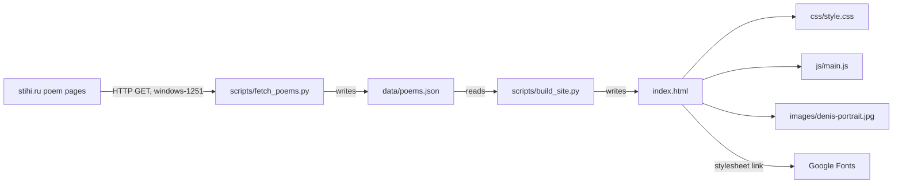

# dmorozov-poems — documentation

A static, single-page website that presents 50 Russian poems first published by
their author on stihi.ru (`https://stihi.ru/avtor/dmorozov`). Two standard-library
Python scripts produce it: one downloads the poems into `data/poems.json`, the
other renders `index.html` from that file. The poems and the portrait belong to
their author, not to the repository owner (`README.md`). The page text is in
Russian; this documentation is in English, like the repository README.

The requirements specification is [`../SPEC.md`](../SPEC.md).

## Status

- Last commit touching the site's own files (`index.html`, `data/`, `scripts/`,
  `css/`, `js/`): `ff4ed8b`, 2026-07-13 (`git log -- index.html css js scripts data`).
  Later commits (up to `222bd72`, 2026-11-07) add and then remove an MIT licence (August 2026),
  move the portrait into Git LFS (`b90b857`), and add the lab tooling and README text.
- Tests: none for the project's code. `recipe.ps1 test` runs pytest and ruff over
  `.claude` only (`recipe.ps1:45-52`), and `.claude/pytest.ini` states that no tests exist yet.
- CI: the five lab Gitea workflows under `.gitea/workflows/` (commit `c7c56a4`); nothing in this
  clone shows a GitHub workflow. Whether a Gitea runner serves them is not recorded
  (`CLAUDE.md` describes both cases).
- Branches of the GitHub copy (`origin` of this clone): `main` ends at `fcfb8f4` (2026-08-07);
  `release` at `222bd72` and `test` at `b4766dd` (2026-11-07). The site files are the same on
  `main` and `release`; the only site-related difference is that `release` stores
  `images/denis-portrait.jpg` as a Git LFS pointer, `main` as the JPEG itself
  (`git diff --stat origin/main origin/release`).
- Evidently unfinished or rough: see [Known limitations](#known-limitations-and-problems).

## Layout

| Path | What it is |
|---|---|
| `index.html` | The whole site, generated by `scripts/build_site.py`; 50 `<article class="poem">` blocks |
| `css/style.css` | Styles: light/dark theme variables, breakpoints at 560 px, 860 px and 861 px |
| `js/main.js` | Theme switch stored in `localStorage`, mobile table-of-contents drawer, "back to top" button |
| `data/poems.json` | The poems: array of `{id, title, date, url, text}` |
| `images/denis-portrait.jpg` | Portrait in the "Об авторе" (about the author) section |
| `scripts/fetch_poems.py` | Downloads the listed poems from stihi.ru into `data/poems.json` |
| `scripts/build_site.py` | Writes `index.html` from `data/poems.json` |
| `run_fetch_poems.bat` | Runs `fetch_poems.py` from the repository root and pauses (Windows) |
| `recipe.ps1`, `.claude/`, `.gitea/`, `.gitattributes`, `.gitignore` | Lab tooling, see [Repository tooling](#repository-tooling) |
| `SPEC.md` | Requirements specification of the scripts, the page and its data |
| `docs/README.md` | This document |

## Architecture

- `fetch_poems.py` holds a fixed list `POEMS` of 50 entries (id, fallback title,
  date, URL path) (`scripts/fetch_poems.py:28-79`). For each one it requests
  `https://stihi.ru/<path>` with a 15 s timeout, decodes the page as windows-1251,
  takes the title from `<h1>` and the text from `
`, and waits
  1.5 s before the next request (`scripts/fetch_poems.py:82-138`).
- `build_site.py` normalises line breaks (2 newlines = line break, 3 or more =
  stanza break), formats dates in Russian, HTML-escapes titles and lines, and
  writes one page with a table of contents, an "about the author" section, the
  poems in file order and a footer (`scripts/build_site.py:37-165`).
- The browser loads Lora and Playfair Display from Google Fonts
  (`scripts/build_site.py:113-115`). No other external service is used by the page.
- Hosting: the README says GitHub Pages serves the site from the `main` branch of
  the GitHub copy (`README.md`). Nothing in the repository configures that; the GitHub
  API reports Pages built from `main`, path `/`, last build from `fcfb8f4` on 2026-08-07
  (checked 2026-11-20; the page itself was not opened). See [Status](#status) for what `main` holds.

## Build and run

Prerequisite: Python 3 (`#!/usr/bin/env python3` in both scripts; no version pinned,
no third-party packages — `scripts/fetch_poems.py:9`, `scripts/build_site.py:9`).
There is no install step and no `requirements` file.

| Step | Command | Source |
|---|---|---|
| Download poems (network, ~74 s of delays: 49 × 1.5 s) | `python scripts/fetch_poems.py` | `README.md`, `scripts/fetch_poems.py:7` |
| Same, on Windows by double click | `run_fetch_poems.bat` | `run_fetch_poems.bat` |
| Regenerate the page | `python scripts/build_site.py` | `README.md`, `scripts/build_site.py:6` |
| View | open `index.html` in a browser | inference: the page loads its own assets by relative paths (only the fonts come from Google) |

Both scripts locate the repository root from their own path, so the working
directory does not matter (`scripts/fetch_poems.py:140-144`, `scripts/build_site.py:95-97`).

## Configuration

There are no environment variables, config files or CLI flags. Settings are
constants in the scripts:

| Constant | Meaning | Value / source |
|---|---|---|
| `BASE` | Site the poems are fetched from | `https://stihi.ru/` — `scripts/fetch_poems.py:23` |
| `HEADERS` | User-Agent of the requests | `scripts/fetch_poems.py:24` |
| `DELAY_SECONDS` | Pause between requests | `1.5` — `scripts/fetch_poems.py:25` |
| `POEMS` | Which poems are fetched, in which order | 50 tuples — `scripts/fetch_poems.py:28` |
| `SITE_TITLE`, `SITE_SUBTITLE` | Page title and heading | `scripts/build_site.py:16-17` |
| `AUTHOR_PROFILE_URL` | Footer link | `scripts/build_site.py:18` |
| `AUTHOR_NAME`, `AUTHOR_PHOTO`, `AUTHOR_BIO` | "About the author" section | `scripts/build_site.py:20-29` |
| `dmorozov-poems-theme` | `localStorage` key for the chosen theme | `js/main.js:5` |

## Usage

- **Change the text of the page** (title, bio): edit the constants in
  `scripts/build_site.py`, run `python scripts/build_site.py`, commit `index.html`
  with the script. `index.html` is not edited by hand (`README.md`).
- **Add a poem**: append a tuple to `POEMS` in `scripts/fetch_poems.py`, run the
  fetch, then the build. Order in `POEMS` is the order on the page.
- **Fix one poem's text by hand**: edit `data/poems.json`, then run the build.
  A later fetch overwrites the whole file.
- **Reader**: the theme button toggles light/dark and remembers the choice; without
  a stored choice the system `prefers-color-scheme` applies (`js/main.js:14-18`,
  `css/style.css:29`). On screens up to 860 px wide (`css/style.css:345`) the ☰ button
  opens the table of contents as a drawer; a tap on the dimmed background or on any
  link in it closes it. The ↑ button appears after 600 px of scrolling
  (`js/main.js:40-78`).

## Testing

No tests cover the scripts, the page or the JavaScript. `.\recipe.ps1 test` sets the
git hooks path, then runs `python -m pytest .claude`, `ruff check .claude` and
`ruff format .claude` (`recipe.ps1:41-54`); pytest exit code 5 (no tests) is accepted.
`python -m pytest .claude --collect-only -q` reports `no tests collected` (exit 5).

Manual check used for this document: rebuilding `index.html` from the committed
`data/poems.json` in a temporary directory gives a file identical to the committed
one except for line endings (the script, run on Windows, writes CRLF; the repository
stores LF, `.gitattributes:1`). The acceptance checks are listed in
[`../SPEC.md`](../SPEC.md#8-acceptance).

## Known limitations and problems

- `fetch_poems.py` exits with code 0 even when poems fail; a failed or empty poem
  is written with `"text": ""` and listed only on stderr (`scripts/fetch_poems.py:125-151`).
  `build_site.py` does not check for empty text, so such a poem would be rendered
  as an empty article.
- Every fetch rewrites the whole `data/poems.json`, including after partial failure
  (`scripts/fetch_poems.py:145`).
- The poem list is fixed; poems published later on stihi.ru are not discovered.
- The fallback titles in `POEMS` differ from all 50 titles stored in
  `data/poems.json` (checked by comparing them); the stored ones came from the
  pages' `<h1>`. A fetch where `<h1>` is missing would put the fallback title on the page.
- Text extraction is regex-based (`
(.*?)
`); a nested
  `
` inside the poem would cut it short (`scripts/fetch_poems.py:99`).
- `build_site.py` puts `poem['id']`, `poem['date']` and `poem['url']` into the HTML
  without escaping (`scripts/build_site.py:63-71`); only titles and text are escaped.
- `toc_entry` computes `first_line` and never uses it (`scripts/build_site.py:87`).
- The hero and meta description insert `SITE_TITLE` in the nominative case after
  "Стихотворения"/"Собрание стихотворений" (`scripts/build_site.py:112,144`).
- The hero says the poems run "от ранних до последних" (from the earliest to the
  latest), but they appear in `POEMS` order, which is newest first: 2025-05-22 down to
  2023-04-05 (`scripts/build_site.py:144`, `scripts/fetch_poems.py:29-78`).
- The meta description calls the page "полное собрание" (the complete collection)
  (`scripts/build_site.py:112`); the code only knows the fixed list of 50, so whether it
  is complete is not checked anywhere.
- The drawer's close button (`data-nav-close`) is rendered with `style="display:none"`
  and no text (`scripts/build_site.py:131`), so `js/main.js:56` wires a button nobody sees.
- The docstring of `fetch_poems.py` says it fetches "all poems by the author" and must be
  run from the repository root (`scripts/fetch_poems.py:3,9-10`); the code fetches only the
  listed 50 and resolves the output path from its own location (`:140-144`).
- Pages are decoded as windows-1251 with `errors="replace"` (`scripts/fetch_poems.py:88`).
  Inference: if the site changed its encoding, the text would be garbled without a
  warning; the committed data has no U+FFFD characters.
- The site title names the author Dmitry, the "about" section names him Denis;
  the README records this without resolving it (`README.md`).
- No licence, on purpose: rights stay with the author (`README.md`).

## Repository tooling

The repository states compliance with revision 4.0.0 of the lab requirements, with
exceptions R-02, R-09, R-18, R-37, R-41, R-42 (`README.md`); its tooling is the lab
standard from [repo-quality-template](https://github.com/IGORSVOLOHOVS/repo-quality-template).
Specific to this project:

- `recipe.ps1`: `$Name = 'dmorozov-poems'`, `$Code = 'dp'`, `$Version = '1.0.0'`,
  `$Needs`, `$Tools` and `$Provides` empty; no `$App`/`$Entry` because nothing is
  installed (`recipe.ps1:9-18`).
- Verbs that act: `test` (over `.claude` only), `info`, and `clean` (removes
  `__pycache__`, `.pytest_cache`, `.ruff_cache`). `build`, `install`, `uninstall`,
  `run`, `publish` print `nothing to <verb>` (`recipe.ps1:40-73`). The README says
  all verbs other than `test` and `info` print that message, which is not true for `clean`.
- Deviation: `.claude/.env` is gitignored and keys are never committed
  (`.gitignore`, `CLAUDE.md` rule 4). Files such as CONTRIBUTING, CHANGELOG, LICENSE
  and the template's `docs/` pages are not present.
- `.gitattributes` stores `*.jpg` through Git LFS; in this clone the portrait is a real
  JPEG, not a pointer (Git LFS 3.7.0 is installed on the machine that holds it);
  `git show HEAD:images/denis-portrait.jpg` prints the LFS pointer.
- `recipe.ps1 test` needs ruff `==0.16.1` (`.claude/ruff.toml`). No file pins a pytest
  version, although the subject of commit `b90b857` says "pin ruff and pytest".

## Related documents

- [`../README.md`](../README.md) — overview and lab exceptions
- [`../CLAUDE.md`](../CLAUDE.md) — working rules for this repository
- [`../SPEC.md`](../SPEC.md) — requirements specification, including the open questions

## About this document

Written 2026-11-18 from commit `222bd72` (branch `release`). Checked again against
the same commit on 2026-11-20, when `../SPEC.md` was added.

Run to check it: `git ls-files`, `git log` (dates), `git branch -a`,
`git diff --stat origin/main origin/release`, `git lfs ls-files`; a Python check
that `data/poems.json` has 50 unique ids, no empty text, the same order, dates and URLs
as `POEMS`, and titles differing from `POEMS`; `build_site.py` run on a copy in a temp
directory and compared byte by byte with the committed `index.html`; the portrait's
size read from its JPEG header (986 × 1280, as in `scripts/build_site.py:78`);
`.\recipe.ps1 info` and `.\recipe.ps1 run` (exit 0); `python -m pytest .claude --collect-only -q`
(Python 3.13.3, pytest 9.1.1).
Not run: `fetch_poems.py` (network), `.\recipe.ps1 test` (ruff is not installed on the
machine that checked this, and the verb rewrites git config and formats files in place),
`.\recipe.ps1 clean`, the page in a browser, the published GitHub Pages site (only its
settings were read through the GitHub API).
